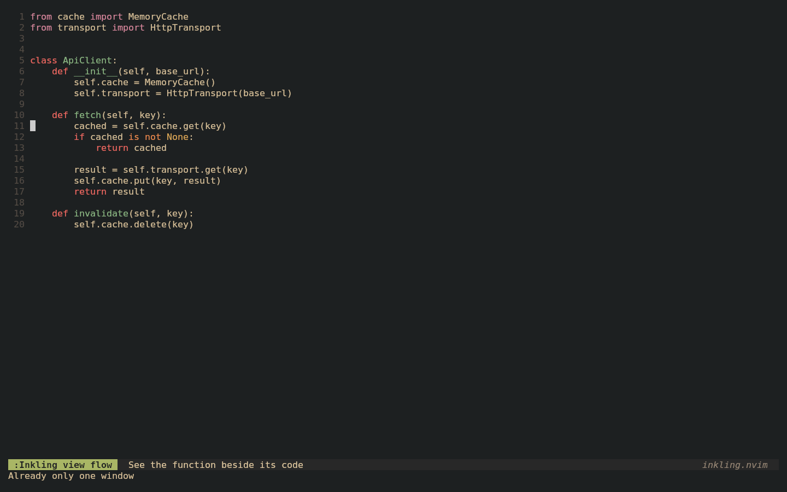
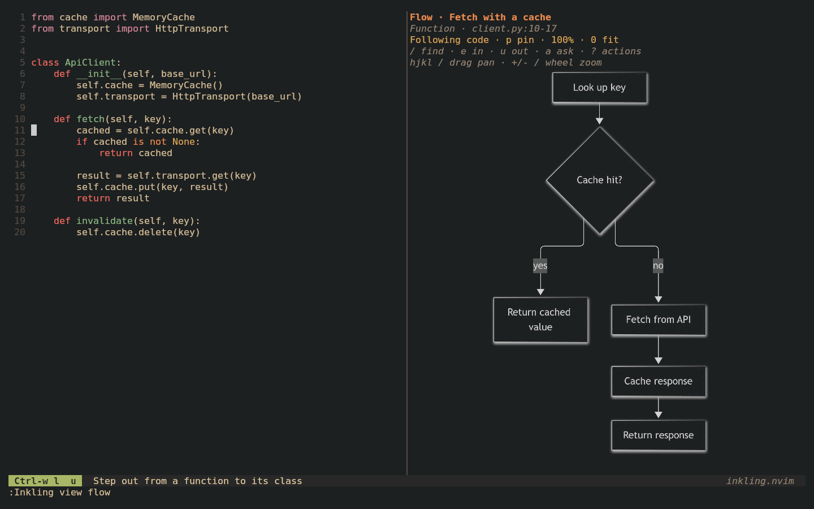
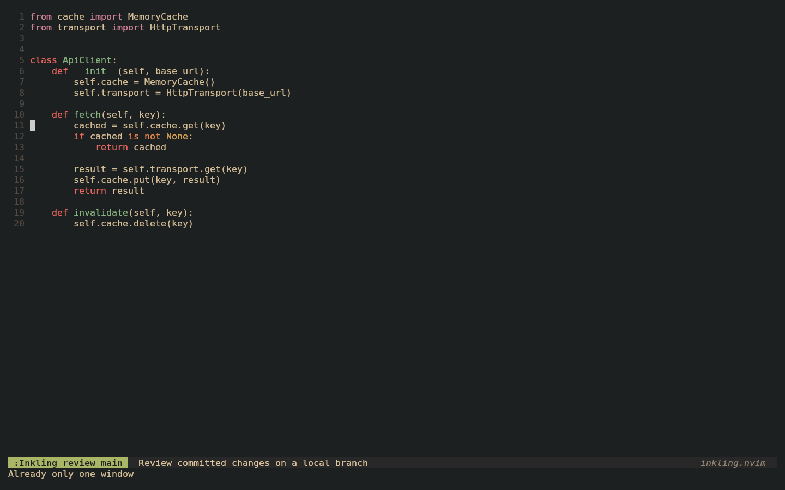

# inkling.nvim

**Read code through diagrams, ask questions, and get AI completions—all inside
Neovim, with your choice of model.**

Inkling draws component and flow diagrams beside your code. Follow a function,
step out to see the bigger picture, step into a dependency, or review a local
branch. Ask questions about the diagram and jump to the source behind an answer.



*Recorded in Neovim with fixed demo responses; generation times are not a
benchmark. [Recording setup and example code](doc/demos/README.md).*

While you write, Inkling also offers inline suggestions (grey "ghost text") and
predicts related edits. Press Tab to accept. Use diagrams, completions, or both.

[Get started](#install) · [Diagram walkthrough](#read-code-through-diagrams) ·
[Branch review](#review-a-local-branch) · [Image setup](#set-up-rendered-diagrams) ·
[Configuration](#configuration)

## Features

- **Diagram workspace**: component and flow diagrams that follow your focus,
  with pan/zoom, source previews, and Mermaid export
- **Explore and ask**: step out to a wider scope, step into a component with a
  prompt, and ask questions with source citations and highlighted paths
- **Local branch review**: compare Changes / Before / After against a Git merge
  base, with evidence from the exact revisions
- **Inline completions** (ghost text) that stream in as the model writes, for the
  current line or a whole block
- **Bring your own model**: Claude Sonnet, OpenAI GPT, any OpenAI-compatible API
  (OpenRouter, LM Studio, vLLM), or a local model with Ollama
- **Project-aware context**: the whole current file, the files it imports, files
  next to it, files that use it, your recent edits, and your project's
  `AGENTS.md` / `CLAUDE.md` / `.cursorrules`
- **Next edit prediction**: after a change, jump to the related edit with Tab and
  apply it with Tab again
- **Spend and acceptance tracking**: cost per day and per model, and how many
  suggestions you actually used
- **Small interface**: one key to accept, one command (`:Inkling`), no
  subscription; you pay your provider per token

## Requirements

- Neovim 0.10 or later
- `curl`
- an API key for Anthropic or OpenAI, or a running [Ollama](https://ollama.com) server
- optional: [`rg`](https://github.com/BurntSushi/ripgrep) (ripgrep), used to find
  files that use the current file

## Install

With [lazy.nvim](https://github.com/folke/lazy.nvim):

```lua
{ 'jbwinters/inkling.nvim', config = function() require('inkling').setup() end }
```

With [vim-plug](https://github.com/junegunn/vim-plug):

```vim
Plug 'jbwinters/inkling.nvim'
" after plug#end():
lua require('inkling').setup()
```

From a local checkout, use its path instead, e.g. `Plug '~/src/inkling.nvim'`.

Full documentation is also available in Neovim with `:help inkling`.

### API keys

inkling reads `$ANTHROPIC_API_KEY` and `$OPENAI_API_KEY`, so start Neovim with
them set. If the key for the active provider is missing, inkling warns you at
startup.

To keep keys out of your environment, give a provider an `api_key` string or
function instead:

```lua
providers = {
  openai = { api_key = function() return vim.trim(vim.fn.system('pass show openai')) end },
}
```

## Usage

| What you want to do | Start here |
| --- | --- |
| Understand a function's decisions and exits | Put your cursor inside it; run `:Inkling view flow` |
| See responsibilities and dependencies | Run `:Inkling view components` |
| Review committed changes on your branch | Run `:Inkling review main` (or your baseline branch) |
| Ask about an open diagram | Run `:Inkling ask What happens if the request fails?` |
| Get inline completions | Start typing; press `Tab` to accept |

Diagrams are opt-in. For a diagram-only setup, disable completion features:

```lua
require('inkling').setup({
  enabled = false,
  next_edit = false,
})
```

Set up a provider below under [Choosing a model](#choosing-a-model).
For graphical diagrams, also follow [Image setup](#set-up-rendered-diagrams);
native text diagrams work without image support.

### Inline completions

Start typing in insert mode. Suggestions appear after a short pause.

| Insert-mode key | Action |
|---|---|
| `Tab` | accept the suggestion (a normal Tab when there is none) |
| `Alt-w` | accept the next word |
| `Alt-l` | accept the next line |
| `Ctrl-]` | dismiss |
| `Alt-\` | ask for a suggestion now |

- **Streaming**: the first line appears as soon as the model starts writing. You
  can type over it or accept part of it while the rest arrives.
- **Typing through**: typing characters that match the suggestion keeps it on
  screen without a new request.
- **Completion menu**: suggestions hide while Vim's completion menu is open, so
  Tab works the menu.

### Next edit prediction

After you change something (leave insert mode, or make a normal-mode edit such
as `cw`, `dd` or `:s`), inkling asks the model whether that change implies
another one in the same file: the next use of a renamed variable, a call site of
a changed signature, or a sibling branch that should match. If it does, the
lines are highlighted and the replacement is shown below them.

| Normal-mode key | Action |
|---|---|
| `Tab` | jump to the predicted edit; press again to apply it |
| `Esc` | dismiss |

These keys are mapped only while a prediction is showing, so Tab keeps its
usual meaning otherwise. Applying a prediction is a single undo step and often
leads to the next one (for example, the next call site).

Each prediction is one request with your recent edits and the current file
(about $0.005 with Sonnet, far less with luna). Turn it off with
`next_edit = false`.

### Commands

| Command | Action |
|---|---|
| `:Inkling` | status: on/off, provider, model, recent response times, today's spend and acceptance |
| `:Inkling on` / `off` / `toggle` | turn suggestions on or off |
| `:Inkling use anthropic` | switch provider |
| `:Inkling use gpt-5.4-mini` | switch model for the current provider |
| `:Inkling use openai/gpt-5.4-mini` | switch both |
| `:Inkling use default` | forget your choice and go back to your config (or automatic) |
| `:Inkling context` | show exactly what the model would see at the cursor |
| `:Inkling spend` | spend and acceptance: today, last 7 days (by day), this month (by model and language), all time |

To turn inkling off for one buffer, set `vim.b.inkling_disabled = true`.

## Read code through diagrams

Start with this loop:

1. Put your cursor inside a function and run `:Inkling view flow`. Code stays on
   the left; its diagram opens on the right. Allow time for the model to respond.
2. Keep browsing code. After you pause in another function, the diagram follows.
3. Press `Ctrl-w l` to enter the diagram. This **pins** its subject. Move with
   `hjkl` or arrow keys to pan; `+` / `-` to zoom; `0` fits the diagram.
   Use `/` to find an element and preview its evidence; `Enter` selects it.
   Press `?` whenever you want to search the available actions.
4. Ask from any window with `:Inkling ask What happens if this request fails?`,
   or press `a` in the diagram, write a question, and send with `Ctrl-S`.
   The answer appears below it. Press `Enter` on an
   answer's source citation to inspect the evidence.
5. Run `:Inkling view follow` to resume browsing, or `:Inkling view close` to
   close the workspace.

Use `:Inkling view components` for nested boxes covering the file and its local
dependencies. Flow view follows the enclosing function when it can identify one.
The scope and whether it is following or pinned appear at the top of the diagram.
Press `v` to choose a view with a description of what each one shows.

### Explore a wider or deeper view



Press **`u` to step out** to a wider perspective: enclosing class when recognized,
then file, containing folders, and project. Each step opens a component overview
and stays pinned. **`b` returns** to the previous diagram and conversation; it
also cancels a new view still generating. **`e` steps in**: choose an element,
then describe what to explore, such as “trace retries into the provider.”
Send with `Ctrl-S`; Inkling can inspect additional source before drawing.
Refresh and view changes preserve the wider boundary; `p` resumes following code.

Folder/project perspectives need `rg` and sample source within the existing
budget. The header names the scope and shows **partial evidence**; `?` exposes
coverage details. These boundaries come from code containment. Recursive detail
presets are planned; `+` / `-` still only change the image's magnification.

These controls answer different needs:

| You want to… | Use |
| --- | --- |
| Read small labels or move around a large diagram | `+` / `-`, pan with `hjkl`, then `0` to fit; no AI request |
| Understand where this function fits | `u` to widen the scope |
| Trace a particular dependency or behavior | `/` to select an element, then `e`; try “trace retries and final failure” |
| Simplify what the current diagram shows | `g`; try “show the main responsibilities and omit helper details” |
| Check a condition without requesting a new view | `a`; try “can retries continue forever?” |
| Return to your previous investigation | `b`, including its conversation |

`g` requests a new diagram within the current scope. `a` adds an answer and can
highlight relevant nodes or paths. `e` can bring more implementation evidence
into scope. There is no automatic recursive-depth slider yet.

### Find elements and move around

If [Telescope](https://github.com/nvim-telescope/telescope.nvim) is installed,
Inkling uses it for fuzzy element search, source previews, and the action menu.
Type to filter, use `Ctrl-n` / `Ctrl-p` to move, and `Esc` to cancel. In the element
picker, `Ctrl-O` opens evidence in your code pane and `Ctrl-A` asks about that
element. Previews show the source snapshot used to generate the diagram.
Without Telescope, selection uses Neovim's `vim.ui.select`.

With Mermaid CLI and a supported image backend, diagrams render as a graphical
canvas in Neovim. **Components** use nested responsibility boundaries and dependency arrows;
**flow** uses execution steps, decision diamonds, branches, and exits. Changing
views generates a new diagram; the old one remains labeled correctly while it loads.

Drag with the left mouse button to pan, and use the wheel to zoom at the pointer.
Keyboard controls are `hjkl` or arrows to pan, `+` / `-` to zoom, and `0` to fit.
Zoom is relative to fit; its upper limit depends on the terminal grid size. Pan and
zoom reuse the rendered image and make no AI requests.

The native text view remains available with `i`, and is the fallback for terminals
without graphics support. In that view, `j` / `k` navigate boxes and source evidence.

| Diagram key | Action |
|---|---|
| `?` | search actions and inspect diagram coverage |
| `Enter` | open selected source evidence, or find an element first |
| `/` | find nodes or relationships with source previews |
| `Esc` | clear the selected element |
| `a` | ask about the diagram or selected element |
| `e` | step into an element with a prompt; Ctrl-S sends |
| `u` | step out to the enclosing class, file, folder, or project |
| `c` | in branch review: choose Changes / Before / After |
| `f` | in branch review: choose a changed file |
| `v` | choose components or flow with descriptions |
| `g` | refine the view, e.g. “show only failure paths” |
| `p` | pin / resume following source focus |
| `r` / `b` | refresh / return to the previous view |
| `m` | render Mermaid in the diagram canvas |
| `M` | export Mermaid source to an editable scratch buffer |
| `i` | switch between native text and Mermaid canvas |
| `hjkl` / arrows | pan the canvas |
| `+` / `-` / `0` | zoom in / out / fit |
| mouse drag / wheel | pan / zoom at the pointer |
| `z` / `q` | maximize or restore the diagram / close the workspace |

These keys apply in the diagram pane. To act from the source pane instead:

```vim
:Inkling view out
:Inkling view in Trace the timeout and retry handling
:Inkling view back
:Inkling view refine Show only failure paths
:Inkling view follow
```

Step-in opens an element picker if nothing is selected. You can also add your
own shortcuts; these are examples, not default global mappings:

```lua
vim.keymap.set('n', '<leader>if', '<cmd>Inkling view flow<cr>', { desc = 'Inkling flow' })
vim.keymap.set('n', '<leader>ic', '<cmd>Inkling view components<cr>', { desc = 'Inkling components' })
vim.keymap.set('n', '<leader>ia', '<cmd>Inkling ask<cr>', { desc = 'Ask Inkling' })
```

### Chat, following, and refresh

Ask with `a` or `:Inkling ask Can a cancelled request still update this buffer?`.
The question editor is a small split: `Enter` adds a line, `Ctrl-S` sends, and
`Esc` then `q` closes it while keeping the draft for that view. The action menu
also offers “Ask about whole diagram” when an element is selected.
The conversation opens below the diagram. Answers can highlight relevant paths
and cite source lines; press Enter on a citation to inspect it. Questions can
read or search additional project files within configured limits. No source code
is edited and no tests are run by the conversation.

Questions and source navigation pin the scope. `:Inkling view follow` resumes
browsing. Source edits mark the current view stale; refresh before investigating
the new revision. Previous views and conversations remain available with `b`.
References are checked against supplied source ranges; semantic correctness still
needs review. Missing evidence and coverage limitations appear below the diagram.

Inkling keeps up to 16 generated diagrams in an in-memory cache and 20 views in
history. Returning to unchanged evidence can reuse a diagram. Pan, zoom, fit,
element selection, and source navigation do not call the model. New scopes,
view types, refinements, and questions can make requests; `r` deliberately
regenerates the current view. Caches do not persist after restarting Neovim.
Use `:Inkling spend` to see diagram and question usage.

### Review a local branch



```vim
:Inkling review main
:Inkling review main feature/my-change
```

The first reviews your current branch; the second reviews the named branch.
Inkling compares its **merge base with `main`** to its tip and pins both commits.
`:Inkling review` without arguments opens a baseline picker.

Start with the change overview, press **`f`** to choose a changed file, then
**`c`** to switch between Changes, Before, and After. Changes labels additions,
removals, modifications, unchanged context, and uncertainty. **`e`** steps into
an element with your prompt; **`u`** steps out; **`b`** returns. **`a`** asks about
behavior across the two versions. `v` still switches components/flow.

Citations identify **before** or **after**. `Enter` opens that exact revision in
a read-only source buffer, including removed code. Your checked-out branch and
unsaved edits stay untouched. Local edits are excluded from the review.

**`r` regenerates the pinned commits.** Run `:Inkling review` again to include
new commits. Views are cached in memory by their evidence and comparison.
Large reviews sample evidence within the configured budget; `?` shows coverage
and `f` includes files not sampled. Diagrams still need human review, and layouts
can change between Before and After. No GitHub/GitLab connection is needed.

The base and head must be available locally. Inkling does not fetch branches.
Commit the changes you want included before starting a review; staged,
unstaged, and unsaved edits are excluded.

### Set up rendered diagrams

Rendered Mermaid uses the [Mermaid CLI](https://github.com/mermaid-js/mermaid-cli)
and an image backend. The default `view.image_backend = 'auto'` chooses:

| Environment | Canvas |
| --- | --- |
| Kitty 0.28+ or Ghostty, with `termguicolors` | Direct Kitty graphics protocol; no image plugin or ImageMagick needed |
| Other terminals with configured [image.nvim](https://github.com/3rd/image.nvim) and ImageMagick | Uses that plugin's backend: Sixel, Überzug++, or Kitty |
| Missing or failing image support | Native text diagrams, with source navigation and chat |

Install Mermaid CLI on PATH, or into Inkling's data directory (find it with
`:echo stdpath('data')`):

```sh
npm install --prefix ~/.local/share/nvim/inkling/mermaid @mermaid-js/mermaid-cli
```

Mermaid needs a Chromium browser. Inkling uses `view.mermaid.browser` when set,
otherwise a detected Chrome/Chromium executable, otherwise Puppeteer's default.
For the direct backend in tmux, enable `allow-passthrough` for the window or pane. Enable Neovim mouse
input with `:set mouse=a`; tmux mouse routing helps when using multiple panes:

```tmux
set -g allow-passthrough on
set -g mouse on
```

The plugin does not change your tmux or terminal settings. `:Inkling view mermaid`
(or `m`) opens the canvas; `:Inkling view export` (or `M`) opens Mermaid source.
`:Inkling view fit`, `zoom-in`, and `zoom-out` also control the camera.
Images render at 4× resolution by default (`view.mermaid.scale`, from 1 to 6).
Inkling restores cached pixels after terminal focus, resize, and tmux visibility
changes. Press `m` to resend the image manually without another AI request.

For other terminals, install and configure **image.nvim** for your environment,
then let Inkling detect it or set `view.image_backend = 'image.nvim'`. For
example, after installing image.nvim and ImageMagick (`magick` or `convert` on PATH):

```lua
require('image').setup({
  backend = 'sixel',          -- requires a Sixel-capable terminal and ImageMagick build
  processor = 'magick_cli',   -- or use 'ueberzug' above with Überzug++ installed
  window_overlap_clear_enabled = true,
  tmux_show_only_in_active_window = true,
})
```

Follow image.nvim's backend requirements, including its tmux configuration.
Inkling uses your existing setup and does not install or configure image.nvim.
Pan and zoom use the same keys and mouse gestures; this backend converts only
the visible part of the cached PNG, so it can be slower than the direct canvas.
Unsupported terminals (including those offering only iTerm2's image protocol)
use text unless a working image.nvim backend is configured.
`view.image_backend = 'kitty'` explicitly enables the direct protocol when
terminal detection is unavailable; it requires Unicode placeholder support.
`view.renderer = 'native'` always uses text. Press `i` to switch text/canvas;
`m` reports missing image prerequisites.

### If something looks wrong

| Symptom | Try |
| --- | --- |
| Text boxes instead of an image | Press `m` to check image prerequisites; configure Mermaid CLI and an image backend above |
| Canvas disappears after switching tmux panes | Press `m` to restore the cached image; check `allow-passthrough` for the direct backend |
| Labels are too small | `+` to zoom, `hjkl` to pan, or `z` to maximize; `0` fits again |
| Diagram stopped following the cursor | Inspecting it pins the subject; run `:Inkling view follow` |
| Diagram says the source changed | `r` refreshes from current source; previous answers describe the old snapshot |
| Branch review misses a new commit | Run `:Inkling review main` again; `r` keeps the original pinned commits |
| “Rendering Mermaid…” stays visible | This is the local renderer, after diagram generation. Check the browser/CLI setup; `i` switches to text |
| A question is waiting in the editor | `Ctrl-S` sends; `Enter` inserts a newline |

### Diagram configuration

Diagram mode is opt-in and works with `enabled = false` (completions off). It
uses the active provider and logs requests through the existing spend tracker.
The provider must support structured JSON output. Diagram and question costs are
included in spend totals and excluded from cost per accepted suggestion.
Optional settings:

```lua
view = {
  provider = nil, model = nil, -- inherit, or choose independently of completions
  debounce_ms = 700,
  max_tokens = 5000, timeout = 60,
  max_chars = 60000, max_files = 8,
  max_nodes = 24, max_edges = 48,
  max_reads = 2,               -- extra evidence rounds per question
  renderer = 'auto',          -- prefer Mermaid; or 'native' / 'mermaid'
  image_backend = 'auto',     -- direct Kitty/Ghostty, then image.nvim; or force either
  mermaid = { command = 'mmdc', browser = nil, scale = 4 },
},
```

Component, flow, and local Git branch review views are available now. ERDs
are planned in the [product requirements](doc/diagram-mode-prd.md).

## Choosing a model

inkling uses the first of these that applies:

1. your last `:Inkling use …` choice, which is remembered across sessions
2. `provider` in `setup()`
3. automatic: **gpt-6-luna** if `$OPENAI_API_KEY` is set (cheapest), otherwise
   **claude-sonnet-5-5** if `$ANTHROPIC_API_KEY` is set (most accurate)

| Provider | Default model | Accuracy\* | Speed | Cost per suggestion |
|---|---|---|---|---|
| `anthropic` | `claude-sonnet-5-5` | 35/40 exact | ~1.5s | ~$0.01–0.02 (less when cached) |
| `openai` | `gpt-6-luna` | 23/40 exact | ~1.3–1.8s | ~$0.001 |
| `ollama` | `qwen2.5-coder:7b` | not measured | local | free |

\* Lines restored exactly on a benchmark of real code (`tests/eval.lua`).

- **Ollama** uses the model's native fill-in-the-middle mode with a small prompt
  (8k characters, no project context) to suit local context windows. It hasn't
  been tested against a live Ollama server yet.
- **Other OpenAI-compatible APIs** (OpenRouter, LM Studio, vLLM, ...) work as an
  extra provider with `kind = 'openai'`; see [Configuration](#configuration).

## Spend and acceptance tracking

inkling prices every request from the token usage the provider reports and
appends it to `~/.local/share/nvim/inkling/usage.jsonl`. `:Inkling` shows
today's total; `:Inkling spend` shows the breakdown.

- **Prices** for the default models are built in. Add others with `prices`
  (USD per 1M tokens):
  `prices = { ['model'] = { input = …, output = …, cache_read = …, cache_write = … } }`
- **Cancelled requests** (you kept typing before the reply finished) are listed
  separately as an upper bound, because providers may or may not bill input they
  had already read.
- **Acceptance**: a suggestion counts as accepted when you take it with Tab /
  Alt-w / Alt-l or type it out exactly. `:Inkling spend` shows the acceptance
  rate and the **cost per accepted suggestion** for each model (the best number
  for comparing models), acceptance by language, and how many next-edit
  predictions you applied.

With full project context (about 10k input tokens), a suggestion costs roughly
$0.01–0.02 with Sonnet 5.5 (less when cached) and about $0.001 with luna.

## What the model sees

Each completion request includes:

1. **The whole current file**, with the cursor marked. Files over 60k characters
   are cut to a window around the cursor.
2. **Project context** (up to 40k characters):
   - **Upstream**: project files the current file imports. Small files are sent
     whole; larger ones as an outline plus the full definitions of the names
     the current file uses.
   - **Peers**: same-directory files in the same language, as outlines. They're
     ranked by whether the current file uses names they define, by name
     similarity, and by recent edits; other files' tests come last.
   - **Downstream**: files that import the current file, as snippets around
     their uses of it (found with `rg`).
3. **Project instructions**: `.inkling.md`, `AGENTS.md`, `CLAUDE.md`,
   `.cursorrules` or `.github/copilot-instructions.md`, from the file's directory
   up to the repository root, nearest first (up to 6k characters). Put
   conventions there, e.g. "use pytest fixtures, never unittest".
4. **Your recent edits**: diffs of what you changed in the last few minutes, in
   any file (up to 5 files and 4k characters). If you just renamed a method in
   one file, completions in another file use the new name.

How it's built:

- **Language support**: imports are resolved for Python, JavaScript/TypeScript,
  Lua, Elixir, Go, Rust and C/C++; outside packages are skipped. Other languages
  get context from referenced file paths, same-extension files, and files that
  mention them. Outlines come from per-language declaration patterns plus
  indentation, so treesitter parsers aren't needed.
- **No waiting**: project context is rebuilt in the background when you switch
  buffers, save, or leave insert mode, so it never delays a suggestion. Recent
  edits update when you leave insert mode or change text in normal mode.
- **Caching**: the parts of the prompt that don't change (project context, and
  the file above the cursor line) are cached by the provider between requests,
  which makes repeat requests faster and cheaper.

To see the exact prompt for the cursor position, run `:Inkling context`.

## Configuration

Everything is optional. These are the defaults, plus an example extra provider:

```lua
require('inkling').setup({
  provider = nil,  -- automatic (see "Choosing a model")
  debounce_ms = 250,
  next_edit = true, next_edit_delay_ms = 500,
  max_tokens = 256,
  prices = {},     -- extra/override prices, USD per 1M tokens
  context = {
    current_file_max_chars = 60000,
    recent_edits = { enabled = true, max_chars = 4000 },
    project = {
      enabled = true, max_chars = 40000, small_file_chars = 3000,
      instructions = true, max_instructions_chars = 6000,
      upstream = true, max_upstream = 10,
      peers = true, max_peers = 15,
      downstream = true, max_downstream = 6,
    },
  },
  disabled_filetypes = { 'help', 'gitcommit', 'gitrebase', 'TelescopePrompt', 'NvimTree', 'nerdtree', 'qf', 'netrw' },
  keymaps = { accept = '<Tab>', accept_word = '<M-w>', accept_line = '<M-l>', dismiss = '<C-]>', trigger = '<M-\\>' },
  providers = {
    anthropic = { model = 'claude-sonnet-5-5' },
    openai    = { model = 'gpt-6-luna' },
    ollama    = { model = 'qwen2.5-coder:7b', url = 'http://localhost:11434/api/generate' },
    -- example: an extra OpenAI-compatible provider
    openrouter = {
      kind = 'openai',
      url = 'https://openrouter.ai/api/v1/chat/completions',
      model = 'qwen/qwen3-coder',
      api_key_env = 'OPENROUTER_API_KEY',
      output = 'json',   -- 'json' (structured output) or 'tags' if the endpoint lacks JSON schema support
      extra_body = {},
    },
  },
})
```

### Colours

Change the suggestion colour with `:hi InklingSuggestion guifg=#665c54`. The
next-edit highlight groups are `InklingEditOld`, `InklingEditNew` and
`InklingEditHint`.

## Development

```
nvim --headless -u NONE -l tests/run.lua anthropic        # request, display, accept (real API)
nvim --headless -u NONE -l tests/context.lua              # outlines + import resolution fixtures
nvim --headless -u NONE -l tests/edits.lua                # recent-edit tracking
nvim --headless -u NONE -l tests/stream.lua               # streaming display (fake provider)
nvim --headless -u NONE -l tests/nextedit.lua             # next-edit prediction (fake provider)
nvim --headless -u NONE -l tests/view.lua                 # diagrams, focus, evidence, conversation (fake provider)
nvim --headless -u NONE -l tests/view_scope.lua           # enclosing scopes, wider evidence, ignore rules and budgets
nvim --headless -u NONE -l tests/view_provider.lua        # diagram provider overrides (fake HTTP)
nvim --headless -u NONE -l tests/view_render.lua          # image lifecycle (fake terminal)
nvim --headless -u NONE -l tests/view_images.lua          # backend selection, camera, cleanup, fallback
nvim --headless -u NONE -l tests/view_canvas.lua          # camera geometry and graphics protocol
nvim --headless -u NONE -l tests/live_context.lua openai  # latency with full project context
INKLING_EVAL_DIR=~/code nvim --headless -u NONE -l tests/eval.lua anthropic 40   # accuracy benchmark
```

`tests/eval.lua` is the accuracy benchmark. It cuts real lines from the code
under `INKLING_EVAL_DIR` (at the start, mid-line, or with a gap in the middle),
asks for completions with full project context, and scores the first suggested
line against the original.

## License

MIT. See [LICENSE](LICENSE).
